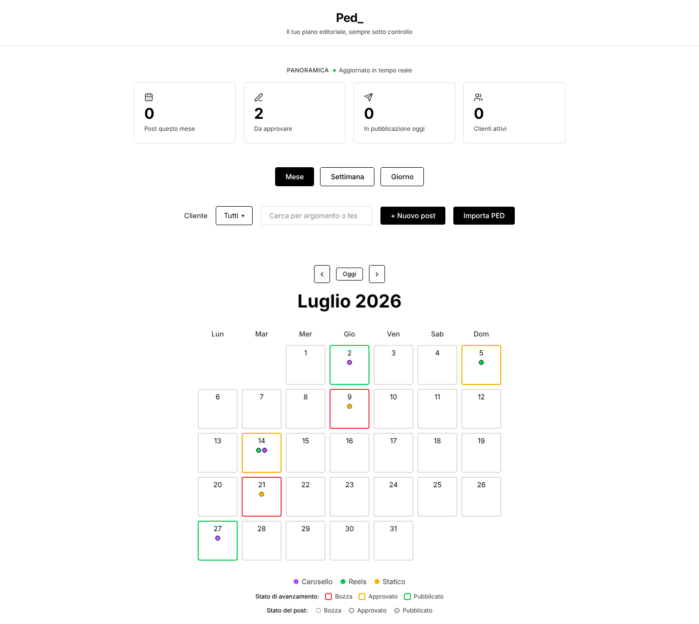
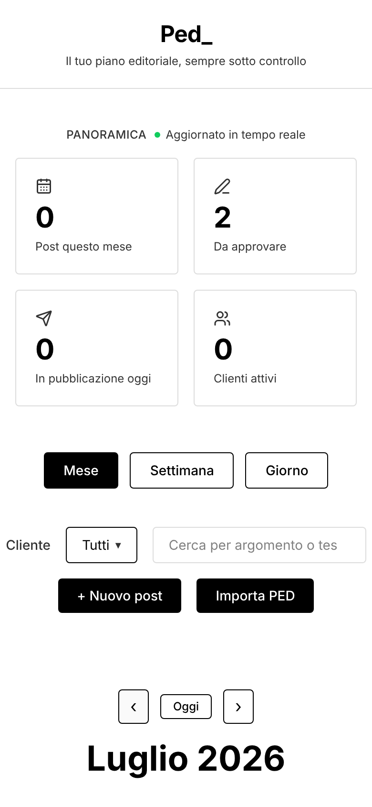

# Ped_ — Editorial Calendar for Social Media

A lightweight web app to plan, track and approve social media content across multiple clients.

I built it for my day-to-day work as a content manager, to replace scattered spreadsheets with one clear view of what is being published, when, and in what state.



## Features

- **Month, week and day views** of the editorial calendar
- **Content types** (carousel, Reel, static post), shown with colour coding
- **Approval workflow**: draft → approved → published
- **Client filter and search** by topic or caption
- **Dashboard** with posts this month, posts awaiting approval and posts going out today
- **Plan import**: paste a plain-text plan or upload a PDF and the posts are created automatically
- **Mobile-first layout**, usable on the go



## Tech stack

React 19 · TypeScript · Vite · pdf.js · lucide-react

Data is stored locally in the browser (`localStorage`), so no account or server is needed.
The sample posts use fictional client names.

## Run it locally

```bash
npm install
npm run dev
```

Then open http://localhost:5173.

## How it was built

I'm a content manager, not a software developer. I built this app with AI coding tools (Lovable first, then Antigravity with Claude), defining the features, testing them in real use and iterating on the design. It is part of how I explore what non-technical professionals can now build with AI.

## Author

**Tommaso Allietta** — Content Manager, Turin (Italy)
[LinkedIn](https://www.linkedin.com/in/tommaso-allietta-885a81196)
